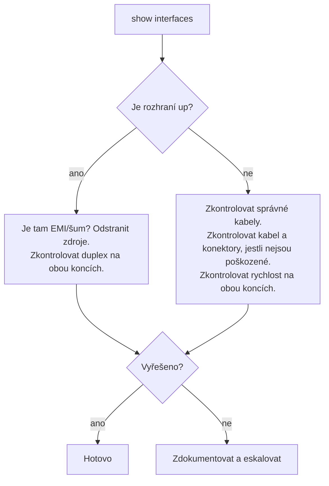

# Ověřování switche a chyby rozhraní

Rozcestník [[Basic_Device_Configuration]]. Viz [[running-config]], [[startup-config]], [[příkazy show]].

## Ověřovací příkazy

| Úkol | Příkaz |
|---|---|
| stav a konfigurace rozhraní | `show interfaces [id]` |
| startup konfigurace | `show startup-config` |
| running konfigurace | `show running-config` |
| [[flash]] | `show flash` |
| hardware a software | `show version` |
| historie příkazů | `show history` |
| IP informace o rozhraní | `show ip interface [id]` / `show ipv6 interface [id]` |
| MAC tabulka | `show mac-address-table` / `show mac address-table` |

## Ověření portu přes running-config

```
S1# show running-config
interface FastEthernet0/18
 switchport access vlan 99
 switchport mode access
!
interface Vlan99
 ip address 172.17.99.11 255.255.255.0
 ipv6 address 2001:DB8:ACAD:99::1/64
!
ip default-gateway 172.17.99.1
```

Ukazuje: F0/18 ve správcovské [[VLAN]] 99, [[SVI]] VLAN 99 s IP, [[default gateway]].

## show interfaces

```
S1# show interfaces fastEthernet 0/18
FastEthernet0/18 is up, line protocol is up (connected)
  Full-duplex, 100Mb/s, media type is 10/100BaseTX
```

- **První parametr** (is up) = fyzická vrstva, přichází nosný signál (carrier detect).
- **Druhý parametr** ([[keepalive|line protocol]]) = linková vrstva, přicházejí keepalive.

**Co znamenají kombinace:**

- interface **up**, protocol **down** = nesoulad enkapsulace, druhá strana je error-disabled nebo hardwarový problém.
- obojí **down** = kabel není zapojen nebo jiný problém s rozhraním (u back-to-back druhá strana administrativně down).
- **administratively down** = ručně vypnuto příkazem `shutdown`.

## Chyby rozhraní

| Chyba | Význam |
|---|---|
| **Input errors** | součet chyb: runts, giants, no buffer, CRC, frame, overrun, ignored |
| **[[runt|Runts]]** | rámce menší než minimum pro médium, Ethernet rámec **pod 64 B** |
| **[[giant|Giants]]** | rámce nad maximum, Ethernet rámec **nad 1 518 B** |
| **[[CRC]]** | vypočtený checksum se neshoduje s přijatým |
| **Output errors** | součet všech chyb, které zabránily odeslání datagramů |
| **[[kolize|Collisions]]** | počet znovu odeslaných zpráv kvůli kolizi |
| **[[late collision|Late collisions]]** | kolize **po 512 bitech** rámce |

- Hodně **CRC** = moc šumu na lince, zkontrolovat kabel, najít zdroj rušení ([[EMI]]).
- **Collisions** na [[half-duplex]] jsou normální, na [[full-duplex]] je nikdy nemáš vidět.
- **Late collisions:** nejčastěji moc dlouhý kabel, nebo [[duplex]] mismatch (jedna strana full, druhá half; late collisions vidíš na straně half). Správně navržená síť je nemá mít nikdy. Řešení: nastavit stejný duplex na obou koncích.

## Troubleshooting – žádné nebo špatné spojení



Související: [[Porty_duplex_a_Auto_MDIX]], [[LED switche]]
