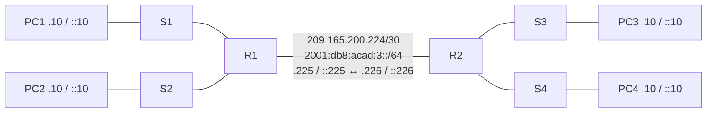

# Rozhraní routeru (dual-stack)

Rozcestník [[Basic_Device_Configuration]]. Viz [[router]], [[IPv4]], [[IPv6]], [[dual-stack]], [[Zakladni_konfigurace_routeru]] (CCNA1).

Router a switch mají podobný modální OS ([[IOS]]), podobné příkazy i základní postup. Do zařízení se vždy dává: **název** (hostname) a **hesla**.

## Základní nastavení

```
Router# configure terminal
Router(config)# hostname R1
R1(config)# enable secret class
R1(config)# line console 0
R1(config-line)# password cisco
R1(config-line)# login
R1(config-line)# exit
R1(config)# line vty 0 4
R1(config-line)# password cisco
R1(config-line)# login
R1(config-line)# exit
R1(config)# service password-encryption
R1(config)# banner motd #Authorized Access Only!#
R1(config)# end
R1# copy running-config startup-config
```

- **[[banner MOTD]]** = právní upozornění na neoprávněný přístup.
- `service password-encryption` jen slabě zašifruje hesla v konfiguraci (typ 7), `enable secret` je hash.
- [[VTY]] linky 0–4, uložení viz [[running-config]] a [[startup-config]].

## Dual-stack topologie



| Síť | IPv4 | IPv6 |
|---|---|---|
| LAN 1 (S1) | `192.168.10.0/24` | `2001:db8:acad:1::/64` |
| LAN 2 (S2) | `192.168.11.0/24` | `2001:db8:acad:2::/64` |
| Spoj R1–R2 (S0/1/0) | `209.165.200.224/30` | `2001:db8:acad:3::/64` |
| LAN 3 (S3) | `10.1.1.0/24` | `2001:db8:acad:4::/64` |
| LAN 4 (S4) | `10.1.2.0/24` | `2001:db8:acad:5::/64` |

R1: G0/0/0 (.1 / ::1), G0/0/1 (.1 / ::1), S0/1/0 (.225 / ::225). R2: G0/0/0, G0/0/1 (.1 / ::1), S0/1/0 (.226 / ::226). PC .10 / ::10.

Layer 2 switche mají víc LAN portů (FastEthernet/GigabitEthernet), **routery** podporují i jiné typy rozhraní (např. **serial**). Adresy a masky: [[IP adresa]], [[maska podsítě]], [[délka prefixu]], viz [[Konfigurace_IP_adresovani]] (CCNA1).

## Konfigurace rozhraní

```
Router(config)# interface type-and-number
Router(config-if)# description description-text
Router(config-if)# ip address ipv4-address subnet-mask
Router(config-if)# ipv6 address ipv6-address/prefix-length
Router(config-if)# no shutdown
```

**Příklad G0/0/0 (LAN 1):**

```
R1(config)# interface gigabitethernet 0/0/0
R1(config-if)# description Link to LAN 1
R1(config-if)# ip address 192.168.10.1 255.255.255.0
R1(config-if)# ipv6 address 2001:db8:acad:1::1/64
R1(config-if)# no shutdown
```

**Příklad G0/0/1 (LAN 2):**

```
R1(config)# interface gigabitethernet 0/0/1
R1(config-if)# description Link to LAN 2
R1(config-if)# ip address 192.168.11.1 255.255.255.0
R1(config-if)# ipv6 address 2001:db8:acad:2::1/64
R1(config-if)# no shutdown
```

**Příklad S0/1/0 (spoj k R2):**

```
R1(config)# interface serial 0/1/0
R1(config-if)# description Link to R2
R1(config-if)# ip address 209.165.200.225 255.255.255.252
R1(config-if)# ipv6 address 2001:db8:acad:3::225/64
R1(config-if)# no shutdown
```

- `description` je jen pro lidi (dokumentace).
- **Bez `no shutdown` je rozhraní vypnuté** (administratively down).

## Loopback

[[loopback|Virtuální rozhraní]], které je pořád up, simuluje síť bez fyzického linku (testování).

```
R1(config)# interface loopback 0
R1(config-if)# ip address 10.0.0.1 255.255.255.0
R1(config-if)# no shutdown
```

Další krok: [[Overovani_primo_pripojenych_siti]].
