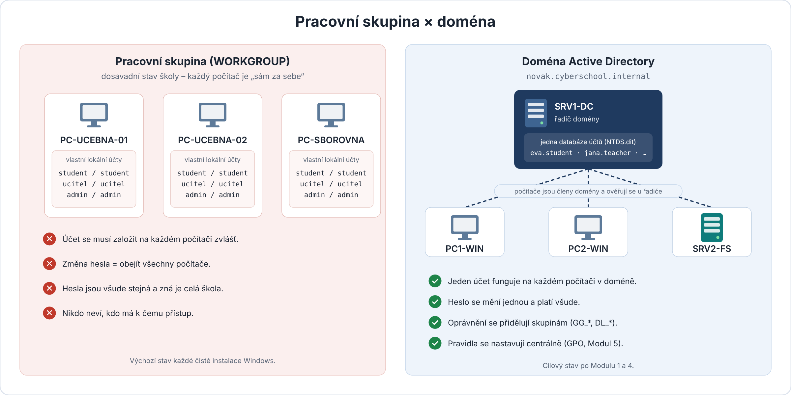
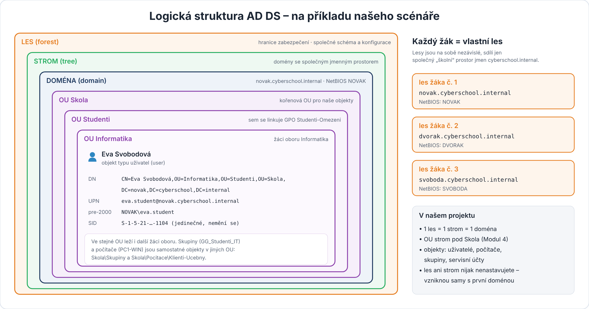
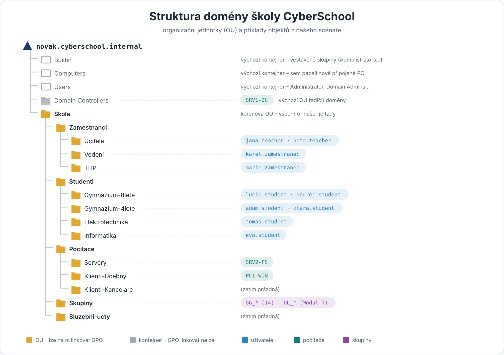
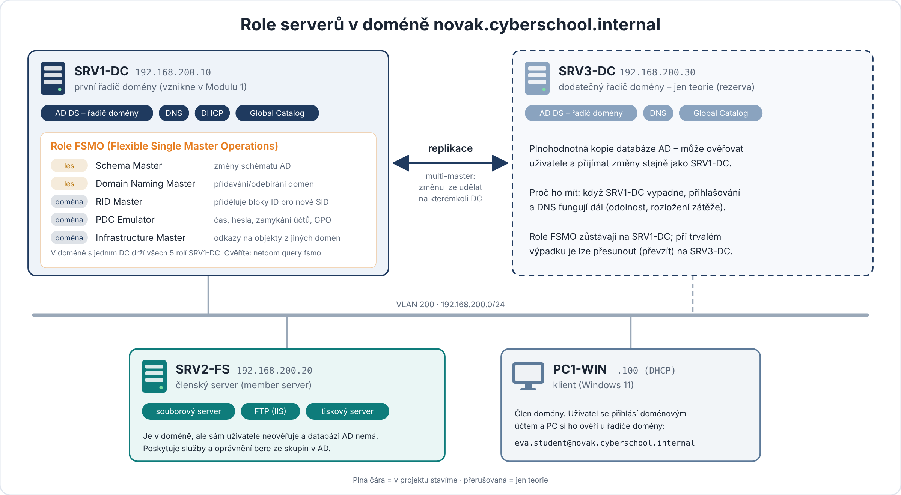

# Část 0: Co je to Active Directory Domain Services?

> Verze: 2026-10-03

> V celé dokumentaci používáme doménu `prijmeni.cyberschool.internal`. Na obrázcích a v příkladech této části je za `prijmeni` dosazené konkrétní příjmení `novak` — vy si všude dosadíte svoje (viz [[#6. Jak pojmenovat doménu|kapitola 6]]).

## 1. Problém: pracovní skupina, nebo doména?



Každá čerstvě nainstalovaná Windows jsou členem **pracovní skupiny (workgroup)**. Každý počítač má svoji vlastní, lokální databázi uživatelů (SAM) a o ostatních počítačích nic neví. Přesně tak dosud fungovala škola CyberSchool:

- Eva se na počítači v učebně přihlašuje lokálním účtem `student`, který existuje na každém PC zvlášť, se stejným heslem.
- Když paní učitelka Nováková změní heslo na svém počítači ve sborovně, na počítači v učebně má pořád to staré.
- Nikdo neumí říct, kdo má k čemu přístup, protože oprávnění jsou rozházená po desítkách počítačů.

**Doména** tohle obrací: existuje **jedna centrální databáze** uživatelů, počítačů a skupin, kterou spravuje server — **řadič domény (Domain Controller, DC)**. Počítače se do domény připojí (*join*) a od té chvíle při každém přihlášení neověřují uživatele samy, ale zeptají se řadiče domény. Eva má jeden účet `eva.student`, který funguje na kterémkoliv školním počítači, a heslo mění jednou.

## 2. Co je Active Directory Domain Services

**Active Directory Domain Services (AD DS)** je role Windows Serveru, která z obyčejného serveru udělá řadič domény. Je to **adresářová služba** — něco jako školní matrika a vrátnice v jednom:

| Úkol | Co to znamená | Příklad ze scénáře |
|---|---|---|
| **Evidence (adresář)** | uchovává informace o všech objektech: kdo existuje, do které skupiny patří, kde v organizaci je | Eva je žákyně oboru Informatika, patří do skupiny `GG_Studenti_IT` |
| **Ověření (autentizace)** | „Jsi opravdu ten, za koho se vydáváš?“ — kontrola jména a hesla | Eva zadá na PC1-WIN jméno a heslo, SRV1-DC ho ověří |
| **Autorizace** | „Co smíš?“ — podle členství ve skupinách se rozhoduje o přístupu ke zdrojům | Eva smí číst `Verejne`, ale nesmí do `Vedeni` |
| **Centrální správa** | nastavení se dělá jednou na serveru a platí všude | zásady skupiny (Modul 5) zakážou žákům Ovládací panely |

Pod kapotou se potkáte s několika pojmy, které se vám budou vracet:

- **`NTDS.dit`** — soubor s databází AD na každém řadiči domény (výchozí cesta `C:\Windows\NTDS`).
- **`SYSVOL`** — sdílená složka na každém DC, ve které jsou uložené zásady skupiny (GPO) a přihlašovací skripty. Klienti si z ní při přihlášení stahují pravidla.
- **LDAP** (Lightweight Directory Access Protocol, port 389) — protokol, kterým se nástroje i aplikace ptají adresáře („najdi uživatele `eva.student`“).
- **Kerberos** (port 88) — protokol, kterým se v doméně ověřují uživatelé. Po úspěšném přihlášení dostane uživatel od DC „lístek“ (ticket) a s ním se prokazuje dalším serverům — heslo už po síti znovu neposílá.
- **DNS** — bez něj klienti řadič domény vůbec nenajdou (viz [[#7. Proč AD DS nefunguje bez DNS|kapitola 7]]).

## 3. Logická struktura: les, strom, doména, OU, objekty



Active Directory je hierarchie „krabic v krabicích“. Od největší po nejmenší:

| Pojem | Co to je | V našem scénáři |
|---|---|---|
| **Les (Forest)** | Nejvyšší úroveň a **hranice zabezpečení**. Všechny domény v lese sdílejí společné schéma (definici, jaké typy objektů a atributů existují) a konfiguraci. | Jeden les. Vznikne automaticky s první doménou. Každý žák má **svůj vlastní, nezávislý les**. |
| **Strom (Tree)** | Skupina domén se souvislým jmenným prostorem (např. `cyberschool.internal` a pod ní `brno.cyberschool.internal`). | Jeden strom s jedinou doménou. |
| **Doména (Domain)** | Základní jednotka správy. Identifikuje ji DNS jméno a kratší **NetBIOS jméno**. | `novak.cyberschool.internal`, NetBIOS `NOVAK` |
| **Organizační jednotka (OU)** | „Složka“ uvnitř domény pro logické třídění objektů. Na OU lze **linkovat zásady skupiny (GPO)** a delegovat správu. | `Skola`, `Skola\Studenti\Informatika`, `Skola\Zamestnanci\Ucitele`… (Modul 4) |
| **Kontejner (Container)** | Také „složka“, ale **nelze na ni linkovat GPO**. Vytváří se automaticky. | `Users`, `Computers`, `Builtin` — proto si zakládáme vlastní OU `Skola` |
| **Objekt (Object)** | Konkrétní položka v adresáři s atributy (jméno, heslo, členství…). | uživatel, počítač, skupina — viz tabulka níže |
| **Lokalita (Site)** | Fyzické (síťové) umístění — skupina IP podsítí propojených rychlou linkou. Řídí, který DC klient použije a jak často se replikuje. | Jedna výchozí lokalita `Default-First-Site-Name` |

> **Pozor na záludnost:** `Domain Controllers` vypadá v ADUC podobně jako kontejnery, ale je to **OU** (proto je na ni nalinkovaná výchozí GPO *Default Domain Controllers Policy*). Naopak `Users` a `Computers` jsou opravdu kontejnery.

### Typy objektů — co bude co v našem scénáři

| Typ objektu | K čemu slouží | Příklady ze scénáře | Kde leží |
|---|---|---|---|
| **Uživatel (User)** | účet osoby, která se přihlašuje | `eva.student`, `jana.teacher`, `marie.zamestnanec` | `Skola\Studenti\<obor>`, `Skola\Zamestnanci\…` |
| **Počítač (Computer)** | účet počítače připojeného do domény — i počítač se v doméně „přihlašuje“ | `PC1-WIN`, `SRV2-FS`, `SRV1-DC` | `Skola\Pocitace\…`, `Domain Controllers` |
| **Globální skupina (GG_)** | sdružuje uživatele **podle role** | `GG_Studenti_IT`, `GG_Ucitele`, `GG_PK_Matematika` | `Skola\Skupiny` |
| **Doménová lokální skupina (DL_)** | nese **oprávnění ke konkrétnímu zdroji** | `DL_FS_Verejne_Cteni`, `DL_FS_Vedeni_Zapis` (Modul 7) | `Skola\Skupiny` |
| **Servisní účet** | účet pro službu/aplikaci, ne pro člověka | (zatím žádný, OU připravená) | `Skola\Sluzebni-ucty` |
| **GPO** | sada pravidel, linkuje se na OU nebo doménu | `Studenti-Omezeni`, `Zakladni-Zasady-Domeny` (Modul 5) | uložené v `SYSVOL`, linkované na OU |
| **Sdílená tiskárna** | lze ji publikovat v AD, aby ji uživatelé našli | `Tiskarna-Ucebna-Informatiky` (Modul 8) | pod počítačovým objektem `SRV2-FS` |

Celý strom OU, který postavíte v Modulu 4, vypadá takto:



### Jak se objekt v AD „jmenuje“

Jeden a tentýž uživatel má v AD několik identifikátorů — a v různých nástrojích potkáte různé z nich. Na příkladu Evy:

| Identifikátor | Hodnota | Kde ho uvidíte |
|---|---|---|
| **Distinguished Name (DN)** — úplná cesta v adresáři | `CN=Eva Svobodová,OU=Informatika,OU=Studenti,OU=Skola,DC=novak,DC=cyberschool,DC=internal` | PowerShell (`-SearchBase`, `-Path`), ADSI Edit |
| **User Principal Name (UPN)** — přihlašovací jméno ve tvaru e-mailu | `eva.student@novak.cyberschool.internal` | přihlašovací obrazovka Windows |
| **sAMAccountName** se jménem domény (starší tvar) | `NOVAK\eva.student` | `whoami`, oprávnění NTFS, FTP |
| **SID** (Security Identifier) | `S-1-5-21-…-1104` | ACL na souborech; uživatel ho má na celý život — po přejmenování zůstává stejný |

> DN se čte **zprava doleva** jako adresa na obálce: doména `internal` → `cyberschool` → `novak`, v ní OU `Skola` → `Studenti` → `Informatika`, a v ní objekt `Eva Svobodová`.

## 4. Fyzická struktura: řadiče domény a replikace

Logická struktura (les, doména, OU) popisuje, *jak jsou data uspořádaná*. Fyzická struktura popisuje, *kde data skutečně leží* — na řadičích domény.

- Každý řadič domény má **plnou kopii** databáze své domény (`NTDS.dit`).
- Řadiče domény jsou si **rovnocenné**: změnu (nový uživatel, změna hesla) lze provést na kterémkoliv z nich a ostatním se automaticky přenese. Tomu se říká **multi-master replikace**.
- Doporučení pro reálný provoz: **vždy alespoň dva řadiče domény**. Když jediný DC vypadne, nikdo se nepřihlásí a nefunguje ani DNS.

V našem projektu máme kvůli jednoduchosti jen jeden DC (SRV1-DC). Adresa `192.168.200.30` je v plánu sítě rezervovaná pro případný druhý řadič — v tomto projektu ho ale jen popisujeme teoreticky.

## 5. Role serverů v doméně



| Role | Popis | V našem scénáři |
|---|---|---|
| **Řadič domény (DC)** | server s rolí AD DS, drží kopii databáze AD, ověřuje uživatele | **SRV1-DC** (`.10`) |
| **Dodatečný řadič domény (Additional DC)** | další DC v existující doméně — stejná práva i data jako první DC, zajišťuje odolnost a rozložení zátěže. V průvodci se vytvoří volbou *Add a domain controller to an existing domain*. | SRV3-DC (`.30`) — **jen teorie** |
| **RODC (Read-Only DC)** | řadič jen pro čtení, s neúplnou kopií hesel — pro pobočky, kde server není fyzicky zabezpečený | nepoužíváme |
| **Členský server (Member Server)** | server připojený do domény, poskytuje služby (soubory, tisk, web), ale sám uživatele neověřuje | **SRV2-FS** (`.20`) |
| **Samostatný server (Standalone)** | server mimo doménu, v pracovní skupině | SRV2-FS před připojením do domény (Modul 0) |
| **Klient** | pracovní stanice v doméně | **PC1-WIN** (DHCP `.100`–`.200`) |

### Role FSMO — operace, které smí dělat jen jeden

I když jsou si řadiče domény rovné, existuje pět operací, u kterých by souběžné změny na více DC způsobily konflikt. Proto je vždy vykonává **jen jeden určený DC** — říká se jim role **FSMO** (*Flexible Single Master Operations*, čti „fizmo“):

| Role | Platí pro | Co dělá | Co se stane, když DC s rolí vypadne |
|---|---|---|---|
| **Schema Master** | celý les | jediný smí měnit schéma AD (např. při instalaci Exchange) | nejde rozšířit schéma; běžný provoz nepoznáte |
| **Domain Naming Master** | celý les | jediný smí přidat nebo odebrat doménu v lese | nejde přidat doménu; běžný provoz nepoznáte |
| **RID Master** | doména | přiděluje ostatním DC bloky čísel (RID) pro tvorbu SID nových objektů | po vyčerpání přiděleného bloku nejde zakládat nové uživatele a skupiny |
| **PDC Emulator** | doména | hlavní zdroj času v doméně, okamžitě se dozvídá změny hesel, řeší zamykání účtů, výchozí cíl pro úpravy GPO | **poznáte nejdřív** — rozjedou se hodiny (a Kerberos přestane fungovat), problémy se změnou hesla |
| **Infrastructure Master** | doména | udržuje odkazy na objekty z jiných domén | v lese s jedinou doménou bez dopadu |

V našem scénáři drží **všech pět rolí SRV1-DC** — první řadič nového lesa je dostane automaticky. Ověříte to na SRV1-DC příkazem:

```powershell
netdom query fsmo
```

nebo v PowerShellu:

```powershell
Get-ADForest | Select-Object SchemaMaster, DomainNamingMaster
Get-ADDomain | Select-Object PDCEmulator, RIDMaster, InfrastructureMaster
```

Kdyby existoval SRV3-DC, role by mohly zůstat na SRV1-DC a v případě trvalého výpadku by se daly na SRV3-DC přesunout (*transfer*) nebo násilně převzít (*seize*).

### Global Catalog (GC)

**Global Catalog** je další role, kterou může mít řadič domény. Obsahuje zkrácený výpis (jen nejdůležitější atributy) **všech objektů z celého lesa** a slouží k rychlému vyhledávání napříč doménami. Při přihlášení se z něj zjišťuje členství v univerzálních skupinách. V lese s jednou doménou má roli GC typicky každý DC — i SRV1-DC (v průvodci zůstane zaškrtnuté *Global Catalog (GC)*).

> **Primární × sekundární?** Tato slova se v dnešním Windows Serveru používají u **DNS zón** (primární zóna = zapisovatelná, sekundární = kopie jen pro čtení, viz Modul 3), ne u řadičů domény.

## 6. Jak pojmenovat doménu

Název domény se volí při povýšení prvního DC a **později se mění velmi obtížně** — vyplatí se ho vybrat dobře.

**Pravidla dobré praxe:**

- **Nepoužívejte `.local`** — koliduje s protokolem mDNS (Bonjour, Apple, některé tiskárny) a působí těžko hledatelné problémy.
- **Nepoužívejte vymyšlené domény nejvyšší úrovně** (`.lab`, `.corp`, `.skola`) — nejsou nikde rezervované a kdokoliv si je může v budoucnu zaregistrovat jako veřejné.
- **V ostrém provozu** se používá **subdoména domény, kterou organizace skutečně vlastní** — např. škola s webem `cyberschool.cz` pojmenuje AD `ad.cyberschool.cz`.
- **Pro privátní a laboratorní sítě** je od 29. 7. 2024 oficiálně vyhrazená doména **`.internal`** (rozhodnutí ICANN). Nikdy nebude veřejně přidělena, takže nehrozí kolize s internetem.
- **NetBIOS jméno** (krátké jméno domény, např. `NOVAK`) má maximálně **15 znaků** a průvodce ho automaticky odvodí z prvního slova DNS jména.
- **Bez diakritiky a mezer** — jen písmena, číslice a pomlčka.

**Naše konvence:**

```
<prijmeni>.cyberschool.internal
```

- `cyberschool.internal` je „jmenný prostor školy“ — stejně jako firma vlastní `firma.cz`.
- `<prijmeni>` je vaše příjmení bez diakritiky, malými písmeny (Dvořák → `dvorak`, Šťastná → `stastna`). Příjmení delší než 15 znaků zkraťte.
- Každý z vás tak má **vlastní, nezávislý les** — a z každého screenshotu, výpisu `whoami` nebo `gpresult` je hned vidět, čí je to práce.

| Žák | DNS jméno domény | NetBIOS jméno | Přihlášení Evy |
|---|---|---|---|
| Jan Novák | `novak.cyberschool.internal` | `NOVAK` | `NOVAK\eva.student` |
| Petra Dvořáková | `dvorakova.cyberschool.internal` | `DVORAKOVA` | `DVORAKOVA\eva.student` |

## 7. Proč AD DS nefunguje bez DNS

Klientský počítač neví, který server je řadič domény. Zjistí to dotazem do DNS na speciální **SRV záznamy**, které DC při povýšení sám zaregistruje, např.:

```
_ldap._tcp.dc._msdcs.novak.cyberschool.internal   →  srv1-dc.novak.cyberschool.internal
_kerberos._tcp.novak.cyberschool.internal          →  srv1-dc.novak.cyberschool.internal
```

Proto platí dvě pravidla, která v projektu dodržujeme:

1. Role **DNS Server** se instaluje spolu s AD DS na řadič domény (průvodce to udělá za vás).
2. Všechny počítače v doméně musí mít jako DNS server nastavený **řadič domény** (`192.168.200.10`) — nikdy přímo veřejný DNS jako `8.8.8.8`. Na internet se SRV1-DC zeptá sám přes *forwarders*.

Nejčastější příčina chyby „doména nebyla nalezena“ při připojování PC do domény je právě špatně nastavený DNS na klientovi. DNS podrobně řeší Modul 3.

## 8. Funkční úrovně lesa a domény

**Funkční úroveň** (*functional level*) určuje, jaké funkce AD může les nebo doména používat — a zároveň jaká nejstarší verze Windows Serveru smí být řadičem domény.

- Windows Server 2025 přinesl novou funkční úroveň **Windows Server 2025** (pro bezobslužnou instalaci hodnota `ForestLevel 10` / `DomainLevel 10`), potřebnou mimo jiné pro novou 32k velikost stránky databáze AD.
- Nový les na Windows Serveru 2025 musí mít funkční úroveň alespoň **Windows Server 2016**.
- Funkční úroveň jde jen **zvýšit**, ne snížit. Protože všechny naše řadiče běží na Windows Serveru 2025, můžeme v průvodci klidně ponechat nabídnutou hodnotu.

## 9. Proč to škola potřebuje

CyberSchool je gymnázium a střední průmyslová škola elektrotechniky a informatiky se čtyřmi obory — osmileté gymnázium, čtyřleté gymnázium, elektrotechnika a informatika. Má stovky žáků, desítky učitelů a zaměstnanců a desítky počítačů v učebnách a kabinetech. Bez centrální identity by každý nový žák, každá změna hesla a každé odejmutí přístupu znamenaly ruční zásah na každém počítači zvlášť.

AD DS na SRV1-DC je základ, na kterém stojí všechny další moduly:

- **Modul 2 a 3** — DHCP a DNS obsluhují počítače v doméně.
- **Modul 4** — OU podle oborů a rolí, skupiny a účty všech postav.
- **Modul 5** — zásady skupiny linkované na tyto OU.
- **Modul 6 a 7** — oprávnění ke složkám a FTP přidělená doménovým skupinám.
- **Modul 8** — tiskárny nasazené podle OU a skupin.

## Kontrolní otázky

1. Jaký je rozdíl mezi pracovní skupinou a doménou z pohledu uživatele a z pohledu správce?
2. Proč si v doméně zakládáme vlastní OU `Skola` a nenecháváme uživatele ve výchozím kontejneru `Users`?
3. Napište DN, UPN a starší (pre-2000) přihlašovací jméno pro učitele `petr.teacher` ve vaší doméně (OU `Skola\Zamestnanci\Ucitele`).
4. Co znamená, že replikace AD je multi-master? Proč je přesto potřeba pět rolí FSMO?
5. Výpadek kterého držitele role FSMO pozná uživatel nejdříve a proč?
6. Čím se liší členský server SRV2-FS od řadiče domény SRV1-DC?
7. Proč doménu nepojmenováváme `skola.local` ani `skola.lab`? Co byste zvolili v ostrém provozu?
8. Klient se nemůže připojit do domény s hláškou, že doména nebyla nalezena. Co zkontrolujete jako první?

## Další zdroje

- [Microsoft Learn — Active Directory Domain Services overview](https://learn.microsoft.com/en-us/windows-server/identity/ad-ds/get-started/virtual-dc/active-directory-domain-services-overview)
- [Microsoft Learn — FSMO roles](https://learn.microsoft.com/en-us/troubleshoot/windows-server/active-directory/fsmo-roles)
- [Microsoft Learn — What's new in Windows Server 2025](https://learn.microsoft.com/en-us/windows-server/get-started/whats-new-windows-server-2025)
- [Microsoft Learn — Selecting the forest root domain](https://learn.microsoft.com/en-us/windows-server/identity/ad-ds/plan/selecting-the-forest-root-domain)

> Praktickou část (instalace role AD DS a povýšení SRV1-DC na řadič domény `prijmeni.cyberschool.internal`) řešíte podle [[Modul 1 Domain Controller/__zadani|zadání modulu]] a ověříte podle [[Modul 1 Domain Controller/_vysledek|výsledku modulu]].
